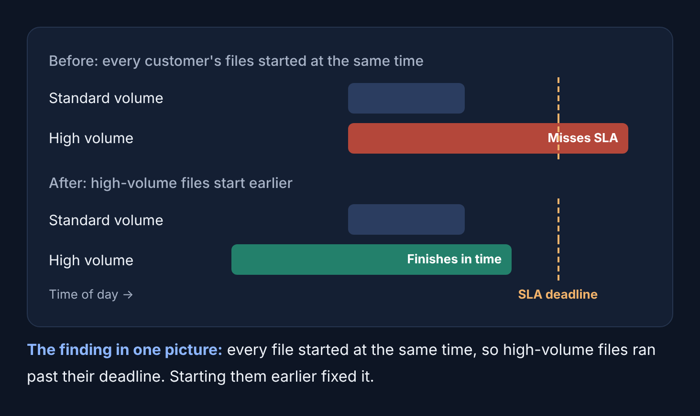
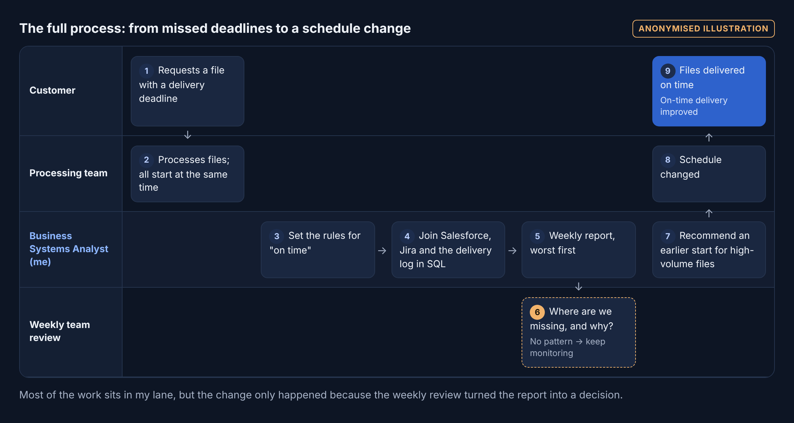
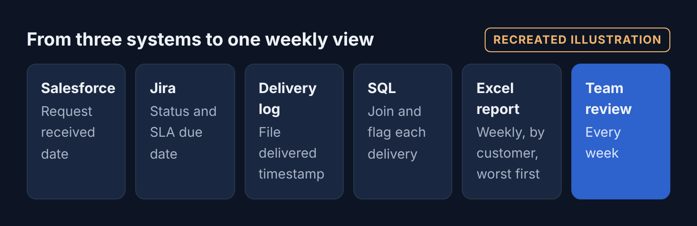

# SLA Performance Analysis

**Business Analysis Experience · Real experience**  
**Role:** Business Systems Analyst II

> Nobody could say how we were performing on SLAs, so I built the measure, and it led to a schedule change that improved on-time delivery.



***The finding in one picture:** every file started at the same time, so high-volume files ran past their deadline. Starting them earlier fixed it.*

📄 **[Read the full case study on the portfolio website](https://cjsmith-page.github.io/experience/02-sla-performance/)**

---

## At a Glance

| | |
|---|---|
| **Problem** | There was no weekly view of SLA performance, so nobody could say which deliveries were late, or why. |
| **What I did** | Joined three systems in SQL, set clear rules for "on time," and built the team's first weekly SLA report. |
| **Result** | Showed that high-volume customers' files were missing deadlines because every file started at the same time. High-volume files now start earlier and finish in time. |

## The Situation

The team delivered files to customers every day, each against an agreed deadline (SLA). The information needed to judge performance was split across three systems: requests in Salesforce, status and due dates in Jira, and delivery times in a delivery log.

No one had joined them up. So when I asked how we were performing on SLAs, there was no clear answer, and late deliveries were only dealt with one at a time, as they came up.

## How I Delivered It

**1. Set the rules before counting anything**  
On time means delivered at or before the SLA due time. Anything undelivered counts as late. The clock runs in each customer's own business calendar.  
*Why:* A measure people argue about doesn't change anything. Agreed rules made the numbers hard to dispute. The business calendar mattered because customers in regions with different working weeks have different deadlines.

**2. Joined three systems in SQL**  
Combined the request date from Salesforce, the status and SLA due date from Jira, and the delivery timestamp from the delivery log, then flagged every delivery as on time or late.  
*Why:* Each system held part of the picture. Only together could they show whether a delivery met its deadline.

**3. Rolled it up into a weekly report**  
Summarised the results by week and by customer, worst first, with average and maximum minutes late, in an Excel report the team reviewed every week.  
*Why:* Sorting worst first put attention where it was needed. Average and maximum delay together separate "slightly late, often" from "very late, occasionally."

**4. Found why the misses clustered**  
The late deliveries were concentrated among the highest-volume customers. Every customer's files started processing at the same time, so the largest jobs ran past their deadline.  
*Why:* Knowing *who* was late wasn't enough. Finding *why* pointed to a fix in the schedule, not in people's effort.

**5. Turned the finding into a change**  
Recommended starting high-volume customers' files earlier. The schedule was changed, and those files now finish before their deadline.  
*Why:* Moving the start time fixed the cause directly, without extra resources or work for other customers.

## The Call I Made

**Count undelivered work as late.** A report that only measures files that were delivered quietly drops the worst cases and makes performance look better than it is. I built the query so nothing could disappear: if it hadn't been delivered, it counted against us.

## Process Flows

### The full process: from missed deadlines to a schedule change



*Most of the work sits in my lane, but the change only happened because the weekly review turned the report into a decision.*

### From three systems to one weekly view



## Artifacts

| Artifact | File | Type |
|---|---|---|
| The core query: join the systems and flag each delivery | [`artifacts/the-core-query-join-the-systems-and-flag-each-delivery.sql`](artifacts/the-core-query-join-the-systems-and-flag-each-delivery.sql) | Simplified |

## Results

**What happened**

- The team had its first weekly SLA report, reviewed every week.
- Missed SLAs were traced to high-volume customers and to the shared start time.
- High-volume files moved to an earlier start, and on-time delivery improved.

**What I would measure next**

- On-time rate for high-volume customers, before vs. after the change.
- Missed SLAs per week, tracked as a trend.
- Maximum minutes late, to catch new outliers early.

## Skills Demonstrated

`SQL` · `Excel` · `KPI definition` · `Root cause analysis` · `Process improvement` · `Salesforce` · `Jira`

## Repository Contents

```
ba-experience-sla-performance/
├── README.md        This case study
├── diagrams/        Overview, process flows and swimlanes (PNG)
└── artifacts/       Recreated artifacts (tables and SQL)
```

Employer and client details are anonymised. Diagrams and artifacts are recreated illustrations and contain no company data.

---

### More Business Analysis Experience

[Collateral Discrepancy Investigation](https://github.com/CJsmith-page/ba-experience-collateral-investigation) · [Screening Platform Request Delivery](https://github.com/CJsmith-page/ba-experience-screening-delivery) · [Requirements and Prototype Delivery](https://github.com/CJsmith-page/ba-experience-requirements-delivery)

**Cudjoe John Smith** · Business Analyst · [Portfolio](https://cjsmith-page.github.io) · [GitHub profile](https://github.com/CJsmith-page) · [LinkedIn](https://www.linkedin.com/in/c-john-smith/)
